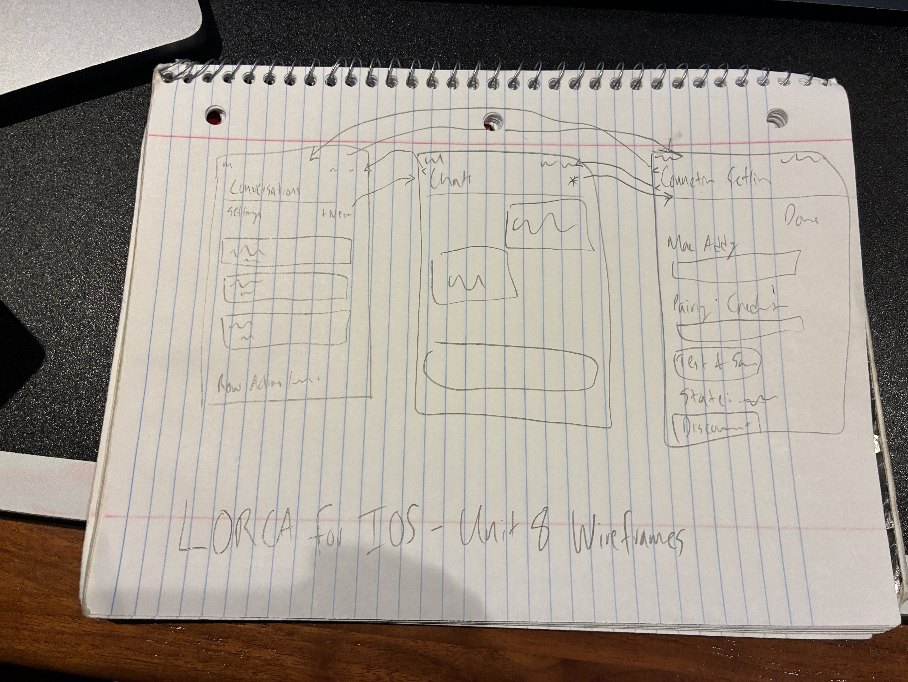
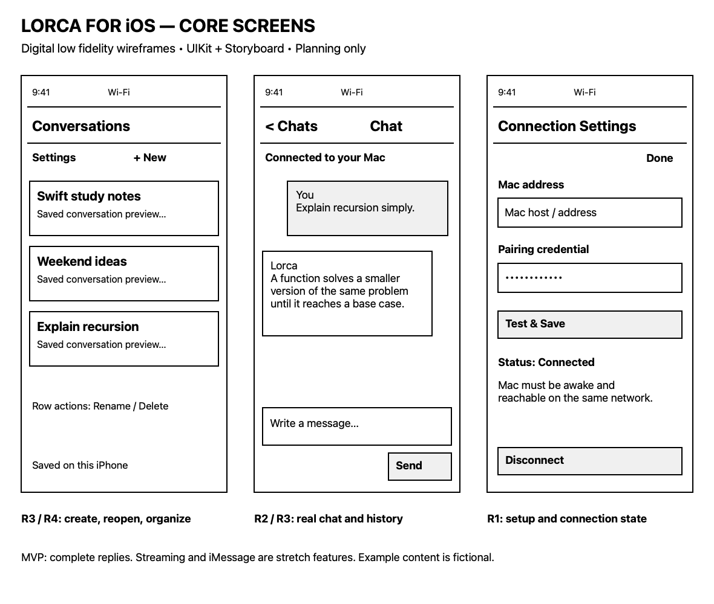
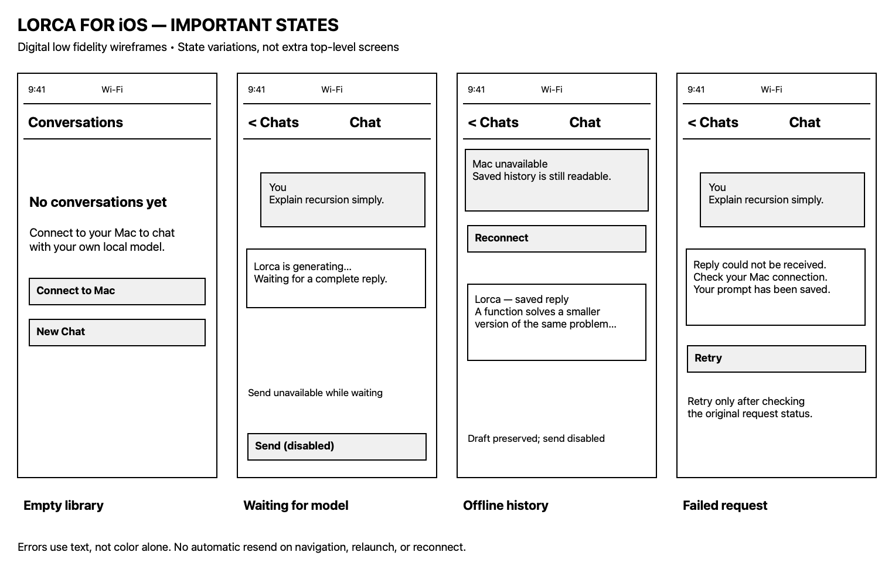
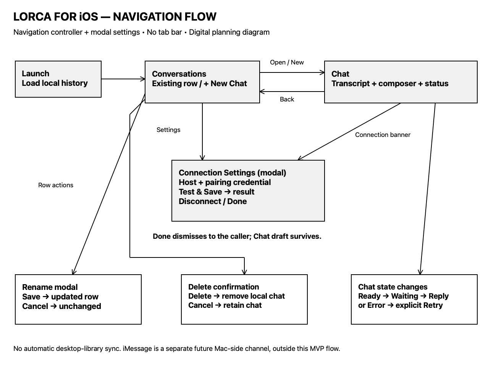
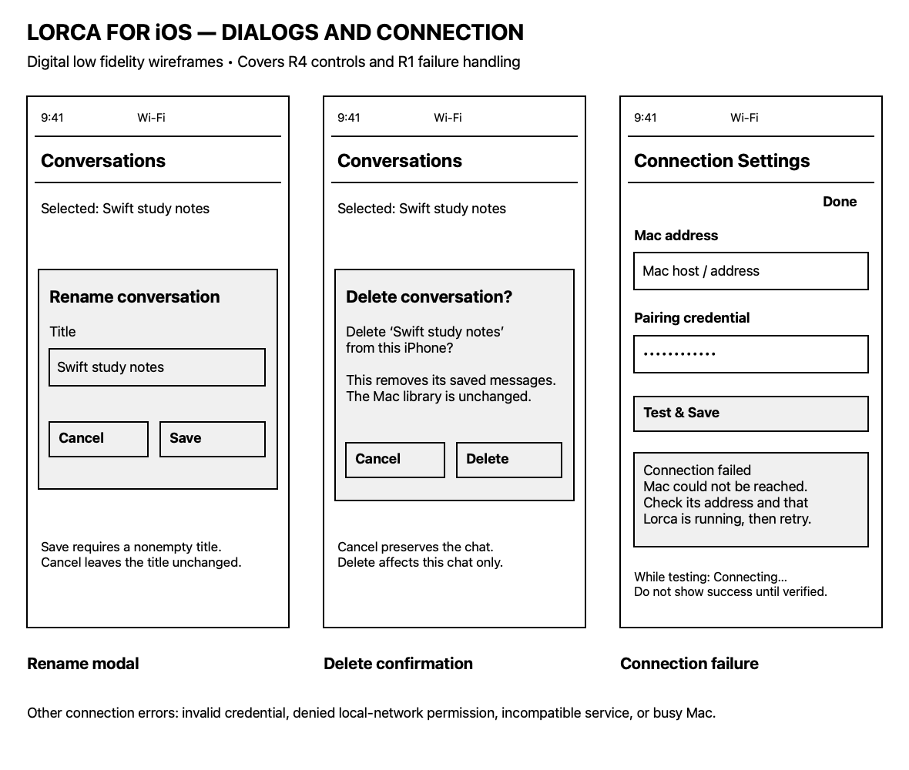

# Lorca for iOS

An original UIKit / Storyboard companion to [Lorca](https://github.com/lalithu/lorca).

**Unit 8 — Capstone Milestone 1 • November 4, 2026**  
**Status:** Digital planning package prepared; course submission remains outstanding; iOS implementation has not started. All application features below are unchecked intentionally. The existing Mac application is prior work and is not claimed as new capstone implementation.

## Table of Contents
1. [Overview](#overview)
2. [Product Spec](#product-spec)
3. [Wireframes](#wireframes)
4. [Milestone 1 and Sprint Plan](#milestone-1-and-sprint-plan)
5. [Schema](#schema)

## Overview

### Description
Lorca for iOS lets a user chat from an iPhone with a local AI model running through Lorca and Ollama on the user's Mac. Users connect to their Mac, create conversations, send text prompts, read replies, and reopen locally saved history. The capstone will use UIKit, Storyboards, Auto Layout, a navigation controller, and table views.

The first release supports one user and one Mac on the same trusted local network while the Mac is awake and Lorca/Ollama are running. Inference runs on the Mac, not the iPhone. Text travels between the devices; this is local inference, not an entirely offline phone app. Historical conversations can be read offline on the phone. Cross-device synchronization of the existing desktop library is outside the MVP.

An optional later iMessage bridge would let the user text a Lorca identity through ordinary Messages and receive replies from the Mac. It is a Mac-side integration, not an iPhone inbox listener. It is not required for the capstone MVP.

### App Evaluation
- **Category:** Productivity / developer tools / personal AI assistant.
- **Mobile:** Quick access to a personally hosted assistant from an iPhone away from the desk, touch-based conversation navigation, and offline reading of saved chats. Optional camera/photo input and iMessage add mobile-native entry points. The MVP's AI request path requires reaching the paired Mac; its mobile value does not imply internet-wide access.
- **Story:** A person who already runs Lorca should be able to ask their own local model a question from their phone without moving to the Mac or switching to a hosted AI provider.
- **Market:** Initially individual Mac and iPhone users who already run Lorca/Ollama and prefer local inference. This is a specific niche, not a claim of measured market demand.
- **Habit:** Short recurring conversations, follow-up questions, and revisiting saved explanations. Users both create prompts and consume responses.
- **Scope:** A text-only, single-Mac companion with connection status, chat, and phone-local history. The existing Rust runtime remains on macOS. The main uncertainty is a securely paired phone-to-Mac transport, which must be validated before expanding scope. A stripped-down version remains useful with completed replies rather than streaming and a manually configured host rather than automatic discovery.

## Product Spec

### 1. User Stories (Required and Optional)

#### Required Must-have Stories
- [ ] **R1 — Connect:** The user can configure one Mac endpoint and pairing credential, test the connection, and see connected, connecting, disconnected, or error status.
- [ ] **R2 — Chat:** The user can send a nonempty text prompt and read a real reply from the Mac's local model. Follow-up prompts retain the selected conversation's context, and separate conversations keep separate contexts. While waiting, the app prevents duplicate submission and displays progress. Failures preserve the prompt and offer an explicit retry.
- [ ] **R3 — Saved history:** The user can create a conversation, see it in a conversation list, reopen it, and read its saved prompts/replies after closing and relaunching the app, including when the Mac is unavailable.
- [ ] **R4 — Organize conversations:** The user can rename a conversation and delete it after confirmation. Deletion applies to this app's phone-local history, not the pre-existing desktop library.

#### Optional Nice-to-have Stories
- [ ] **O1 — iMessage channel:** The user can text an allowlisted Lorca messaging identity and receive a response generated on the Mac, using a separate Mac-side bridge. This includes sender filtering, duplicate/echo suppression, and an explicit enable/disable control on the Mac.
- [ ] **O2 — Streaming and stop:** The user can see response text arrive incrementally and stop generation, with partial-response status saved accurately.
- [ ] **O3 — Image input:** The user can attach a photo for a compatible vision model, with explicit model and permission handling.
- [ ] **O4 — Discovery:** The user can discover a Mac automatically instead of typing its address.

No feature is marked implemented. Digital wireframes demonstrate the intended interface only.

### 2. Screen Archetypes

| Screen / archetype | Purpose and controls | Required stories |
|---|---|---|
| Conversations / Stream | Saved conversation titles and previews; New Chat; Settings; rename and delete actions; empty state | R3, R4 |
| Chat / Detail + Creation | Transcript, multiline prompt field, Send, waiting indicator, explicit retry, connection status | R2, R3 |
| Connection Settings / Settings | Host/address, pairing credential, Test & Save, connection result, Disconnect | R1 |
| Rename / modal | Current title, edited title, Save/Cancel | R4 |
| Delete confirmation / alert | Conversation name, Cancel and Delete; explains local scope | R4 |

The empty, waiting, failed, and offline views are states of these screens, not additional top-level destinations.

### 3. Navigation

#### Tab Navigation (Tab to Screen)
There is no tab bar in the MVP. A navigation controller supports the small hierarchy; Settings is presented modally in its own navigation container. The template asks us to document tab navigation, not to introduce unused tabs.

#### Flow Navigation (Screen to Screen)
- **Launch → Conversations:** load phone-local history and show current connection state. On first launch show an empty state with Connect to Mac and New Chat.
- **Conversations → Chat:** tap an existing conversation, or tap New Chat to create/open an empty one. Back returns to Conversations.
- **Conversations → Connection Settings:** tap Settings or Connect to Mac. Done returns to Conversations.
- **Chat → Connection Settings:** tap a disconnected connection banner. Done returns to the same Chat and preserves its draft.
- **Connection Settings → same screen:** Test & Save displays connecting, then success or an actionable failure. A failed test does not claim a valid connection. Disconnect stops using the connection and returns the state to disconnected; historical chats remain readable.
- **Conversations → Rename modal → Conversations:** choose Rename; Save updates the local title; Cancel leaves it unchanged.
- **Conversations → Delete confirmation → Conversations:** choose Delete; Cancel keeps the conversation; confirmed Delete removes local history for that conversation.
- **Chat → same Chat:** Send creates one request and displays waiting; success saves the reply; failure preserves the prompt and shows Retry. Returning to the screen never automatically resends a request.

### MVP Acceptance Criteria

| Story | Observable acceptance criteria |
|---|---|
| R1 | Successful authorized connection is distinguished from wrong credentials, unreachable Mac, and incompatible service; denied local-network permission is explained. Credentials are not shown in logs/screenshots or stored in plain preferences. |
| R2 | A real prompt reaches Lorca and produces a real model reply; empty prompts cannot be sent; repeated taps do not duplicate a request; a follow-up refers to earlier messages in the selected chat without importing another chat's context; failure is visibly different from an empty successful response. |
| R3 | Create at least two chats, send messages, relaunch, and reopen the correct history. Disconnect the Mac and confirm saved history remains readable. Draft-only chats have a sensible title. |
| R4 | Rename persists after relaunch. Cancelled deletion retains history. Confirmed deletion removes only the selected phone-local conversation. |

### Boundaries and Failure Behavior
- MVP requests originate on the phone. Desktop history import, shared-library editing, and automatic synchronization are not promised.
- One active request at a time. Model/workspace selection, remote code execution, command approvals, Job Apps, Gmail, and Google Sheets integration are outside the MVP.
- Mac offline/asleep: show unavailable status, preserve drafts/history, and let the user explicitly retry after reconnecting.
- App backgrounded or connection lost: do not promise uninterrupted generation or automatic resume. Reconcile request status before any explicit retry; never blindly replay a prompt.
- No public Ollama port, router forwarding, account registration, or cloud model is required for the proposed same-network MVP.
- Sample data in designs is fictional. Demo data must never be represented as a live model response.

## Wireframes

### Hand-sketched Wireframes

Student-drawn low fidelity wireframes show Conversations, Chat, Connection Settings, and navigation arrows. The digital sheets below supplement this overview with readable control labels, Rename/Delete dialogs, and loading/offline/error states.

See the [requirement-by-requirement review](REQUIREMENTS_REVIEW.md) and [wireframe annotations](wireframes/README.md).

### [BONUS] Digital Wireframes & Mockups
These are digital low fidelity planning drawings, not app screenshots or photographs of hand sketches. They show all planned MVP screens, controls, states, and navigation. Bonus credit is subject to instructor evaluation; no Figma source or interactive prototype is claimed.

### [BONUS] Interactive Prototype
Not created. Static flow diagrams are not an interactive prototype, and no prototype GIF is claimed.

## Milestone 1 and Sprint Plan

### November 4, 2026 — Planning
- [x] Six brainstormed concepts and evaluations of the top three: [brainstorming.md](brainstorming.md).
- [x] Selected app, description, and evaluation.
- [x] Required and optional user stories.
- [x] Screen archetypes and navigation flows.
- [x] Digital low fidelity wireframe images and navigation diagram.
- [x] Sprint goals, feasibility risks, and planned acceptance checks: [SPRINT_PLAN.md](SPRINT_PLAN.md).
- [x] Public capstone repository: [lalithu/lorca-ios](https://github.com/lalithu/lorca-ios). Planning documents, digital wireframes, and hand-sketch photo committed.
- [x] Photographed hand-sketched core screens and navigation uploaded and embedded.
- [ ] Course submission through Unit 8 Projects.

**Progress:** Planning artifacts prepared. No Xcode project, iOS app code, Mac bridge, or mobile transport has been implemented for this milestone. A [Milestone 1 planning walkthrough](https://youtu.be/8zSFkHlXAAA) is included; it demonstrates planning work rather than a functioning iOS build. The rubric classifies checked-off app features and a build-progress video as Unit 8 bonus work; the Projects page also uses mandatory-sounding video wording. See [submission checklist](SUBMISSION_CHECKLIST.md) for that unresolved wording conflict.

**Next:** validate the Mac connection architecture, then build the UIKit/Storyboard flow and real chat behavior in bounded sprints. Preserve this milestone entry when adding later progress, challenges, and demo videos.

### Milestone 1 Video

[Watch the Milestone 1 planning walkthrough](https://youtu.be/8zSFkHlXAAA).

This recording walks through the work completed so far: brainstorming, the product specification, and wireframes. It is a planning walkthrough, not a working-app demo; iOS implementation has not started.

### Note on the Unit 8 Video Requirement

The grading rubric lists the Unit 8 build-progress video as bonus work, while the Projects page also uses required-video wording. I have included a video of my completed planning work. If a working-build demonstration is additionally required for this milestone, please let me know; I can provide it as soon as possible.

## Schema

This section will be completed in Unit 9, as directed by the course template. The notes below are planning candidates, not implemented contracts.

### Models
Planned candidates: phone-local Conversation and Message, ConnectionProfile, and a request identifier/status. Decide storage and exact fields in Unit 9. Pairing credentials belong in Keychain, separate from ordinary history.

### Networking
Planned: an authenticated connection to a reachable Mac service that invokes Lorca locally. Existing Lorca transport is loopback-only; secure pairing and a mobile-access adapter are new work. Exact endpoints, protocol, and reconnect behavior are undecided. No Parse backend is assumed.

## References and Attribution
- [Unit 8 Overview and live deadline](https://courses.codepath.org/courses/ios101/unit/8#!overview)
- [Unit 8 Lab](https://courses.codepath.org/courses/ios101/unit/8#!labs)
- [Unit 8 Project](https://courses.codepath.org/courses/ios101/unit/8#!projects)
- [Official Capstone README Template](https://courses.codepath.org/snippets/ios101/readme_templates/capstone_readme)
- [Student grading rubric](https://courses.codepath.org/courses/ios101/pages/grading)
- [Existing Lorca desktop project](https://github.com/lalithu/lorca) — prior personal work: Rust runtime, Ollama integration, macOS UI. The proposed iOS app and iMessage bridge are new work.
- [Lorca transport source](https://github.com/lalithu/lorca/blob/main/src/transport.rs)
- [Apple: local network privacy](https://developer.apple.com/documentation/technotes/tn3179-understanding-local-network-privacy)

Planning text and digital wireframes were prepared with Codex assistance and should be reviewed by the student. No user testing, implementation, or working build is implied.
