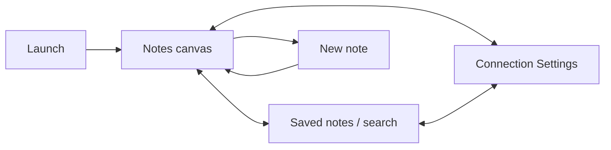

# Lorca iOS

A lightweight **UIKit + Storyboard** notes app. Write naturally; a local model on the same Mac adds editable help beneath your writing. The iOS app runs in **Xcode Simulator**. Light mode, native text editing, no SwiftUI, no third-party app packages.

[Portfolio write-up](https://lalithu.github.io/blog/lorca-ios-notes-capstone/) · [Requirements review](REQUIREMENTS_REVIEW.md) · [Video checklist](VIDEO_DEMO.md)

## Run in Simulator — instructor quick start

**You need:** a Mac, Xcode **26 or newer** with an installed iPhone Simulator runtime, and [Ollama for macOS](https://ollama.com/download/mac). The project targets iOS 17+; current native glass styles are guarded for iOS 26+. This build was checked with Xcode 27.2 and an iOS 18 Simulator. No physical phone, Apple Developer membership, signing team, desktop Lorca app, API key, or server project is needed.

### 1. Start Ollama and download a model

Install and open Ollama on the **same Mac** as Xcode. In Terminal:

```sh
ollama pull qwen3:4b
ollama list
curl http://127.0.0.1:11434/api/tags
```

[Qwen3 4B](https://ollama.com/library/qwen3:4b) is approximately a 2.5 GB download; runtime memory needs are higher than the download size. Allow the first model load to finish. Keep Ollama running. If you use the standalone CLI instead of its Mac app, start `ollama serve` in another Terminal window. If it says the address is already in use, Ollama is already running.

The app was tested with `qwen3:14b`; that larger model is optional. Any selected model must already be installed in Ollama and support the structured responses this app requests. No model weights are bundled.

### 2. Open and run the app

Download this repo with **Code → Download ZIP**, unzip it, and open:

**`ios/LorcaIOS.xcodeproj`**

In Xcode, select the **LorcaIOS** scheme and an installed **iPhone Simulator** destination, then press **⌘R**. Select a Simulator rather than “Any iOS Device.” If no Simulator runtime is installed, add one in Xcode Settings → Components. Notes can be written and saved before connecting the model.

### 3. Connect from inside Lorca iOS

Tap the **gear in the upper-right corner**:

| Field | Enter |
| --- | --- |
| Server address | `http://127.0.0.1:11434` |
| Model name | `qwen3:4b` — replace the initial `qwen3:14b` value |

Tap **Test & Connect**, wait for **Connected**, then **Done**. Simulator reaches the Mac’s localhost directly; leave Ollama on its default loopback configuration. No Wi-Fi IP, port forwarding, or `OLLAMA_HOST` change is needed.

### 4. Try a note

Tap **New note**, then type:

```text
Study guide for counting and permutations:
Explain factorials and give two short worked examples.
```

Pause briefly or start a new paragraph. Three pulsing dots appear beside the passage while the model works. A real response appears below your original writing with blue highlighting. Edit it directly; human changes appear amber and the edited generated block loses its blue highlight. There is no separate response viewer to open.

**If something doesn’t work:**

- **Cannot connect:** keep Ollama open; run the `curl` command above and confirm the address ends in `:11434`.
- **Model not installed:** run `ollama list` and enter the exact installed name, including its tag.
- **Slow first response:** let the model load; close memory-heavy apps or use the smaller 4B model. A timed-out/unfinished request keeps your writing; use **Model following → Retry failed work**.
- **No assistance:** check **Test & Connect**, resume **Model following** if paused, and write a concrete request. Ordinary writing may need no model addition.
- **No cursor:** tap the note canvas. **Done** dismisses editing; tapping the canvas restores it.

## Demo videos

**Milestone 2 — current Notes app:** [Watch the capstone demo](https://www.youtube.com/watch?v=OmjLkg07w2c) — approximately 8 minutes, recorded and uploaded by the student. This is the latest demo; both earlier videos remain below.

Earlier videos are retained as milestone history:

- [Milestone 1 working UIKit/Storyboard prototype](https://www.youtube.com/watch?v=PLGJzfdt1FM) — 1:57.
- [Milestone 1 planning walkthrough](https://youtu.be/8zSFkHlXAAA).

## Completed features — Milestone 2

### Required

- [x] **R1: Notes and persistence.** Create, edit, and reopen notes saved in the Simulator, including when Ollama is unavailable.
- [x] **R2: Real local-model connection.** Configure the endpoint/model, test the installed model, connect/disconnect, and show actionable connection errors.
- [x] **R3: Editable inline help.** Original writing stays; model additions appear below it. Passage-local progress, independent passages, pause/retry, undo/redo, and distinct human edits support continued writing.
- [x] **R4: Organization.** Search saved notes, rename them, and delete with confirmation.

### Optional

- [x] **O1: Checkable task lists.** Model-generated task checkboxes toggle; checked items move below unchecked items.
- [x] **O2: Screenshot text import.** The system photo picker and Apple Vision recognize screenshot text for a local-model summary.
- [x] **O3: Research.** Current-information requests can use Exa search and supply returned evidence to the local model.

AI inference runs on the **Mac**, not on the simulated iPhone. Ordinary note editing and saved notes work offline; AI requires Ollama. Research additionally needs internet and sends a search query to Exa. Screenshot import recognizes text; it is not general visual captioning. Tables are simple inline text columns. Desktop synchronization, calendar/ICS export, authenticated phone pairing, background generation guarantees, and the original iMessage idea are outside this submission.

## App evaluation

- **Category / audience:** productivity; students and local-model users who want to develop rough notes in place.
- **Mobile:** native touch editing, checkable tasks, photo-library input and local saved notes. The instructor evaluates the same iOS app in Simulator.
- **Story / habit:** write assignments, study topics and tasks in one page; revisit and edit the results without maintaining a separate chat.
- **Market / scope:** a focused personal-note tool for people already willing to run a local model. No measured demand is claimed. The MVP is one user's local notes with Mac-hosted inference; no account, sync service or on-device inference.

## Screens and navigation

Launch opens the last selected note, or an empty note on first use. **Notes** is the writing canvas; **New note** creates another. The upper-left list icon opens **Saved notes**, with search and swipe actions. The upper-right gear opens modal **Connection Settings**; Done returns to the same note. The keyboard toolbar offers Undo, Redo, screenshot import, and Done. **Model following** opens pause/resume and retry controls.

All three core scenes are in [Main.storyboard](ios/LorcaIOS/Base.lproj/Main.storyboard), with UIKit, Auto Layout and a navigation controller. No tab bar is needed for this flow.



## Sprint update and verification

**November 18, 2026:** changed the planned chat companion into a notes-first interface while retaining local-model inference and local saved history. UIKit/Storyboard remains the implementation constraint. The original authenticated phone-to-Mac pairing plan was replaced by a simpler **Simulator → localhost Ollama** setup. See [sprint history](SPRINT_PLAN.md) and the [requirement mapping](REQUIREMENTS_REVIEW.md).

Verified on iPhone 16 Pro Simulator / iOS 18: successful build, real `qwen3:14b` connection and inline generation, progress cue appearing/clearing, original-text preservation, relaunch persistence, and cursor focus/tap-to-edit. Other implemented paths have not all been exhaustively tested; no physical-device or iOS 26 glass preview is claimed.

[Actual Simulator screenshot](docs/images/notes-inline.png) · [Architecture / data details](ios/README.md)

## Submission status

- [x] Buildable Xcode project, shared scheme, assets and source included.
- [x] Current README, sprint update, required/optional feature list, setup and video instructions.
- [x] Milestone 1 planning, hand sketch, digital wireframes and both old videos preserved.
- [x] Public repository readable by instructor **aslowle1** without an invitation.
- [x] New demo recorded/uploaded and linked above the older videos.
- [ ] Student submits the repository and video through **Canvas**, per Andros’s email, and checks the CodePath Unit 9 submission entry.
- [ ] Confirm submission receipt. Due **November 18, 2026, 11:59 p.m. EST** per the supplied Unit 9 page.

[Final checklist](SUBMISSION_CHECKLIST.md) · [Preserved Milestone 1 specification and videos](docs/milestone-1.md) · [Brainstorming](brainstorming.md) · [Hand sketch and digital wireframes](wireframes/README.md)

The supplied rubric requires at least **three required features and one optional feature**; the current scope lists four required and three optional. Digital wireframes and an interactive-prototype GIF are bonus items; digital wireframes are included, but no interactive prototype/GIF is claimed. Grading remains the instructor’s decision.

## Build from Terminal (optional)

From the repository root:

```sh
xcodebuild -project ios/LorcaIOS.xcodeproj -scheme LorcaIOS \
  -sdk iphonesimulator -configuration Debug \
  -derivedDataPath /tmp/lorca-ios-build CODE_SIGNING_ALLOWED=NO build
```

UI acceptance tests use the existing local `qwen3:14b` installation. They are not required to launch or grade the app. For normal evaluation, follow the quick start above with the smaller model.

Prior work: [Lorca macOS](https://github.com/lalithu/lorca) and the [original embedded-model interface write-up](https://lalithu.github.io/blog/embedded-model-note-interface/). This capstone is a UIKit/Storyboard iOS implementation. Documentation and implementation were prepared with Codex assistance and reviewed by the student; model responses remain editable and may be incorrect.
